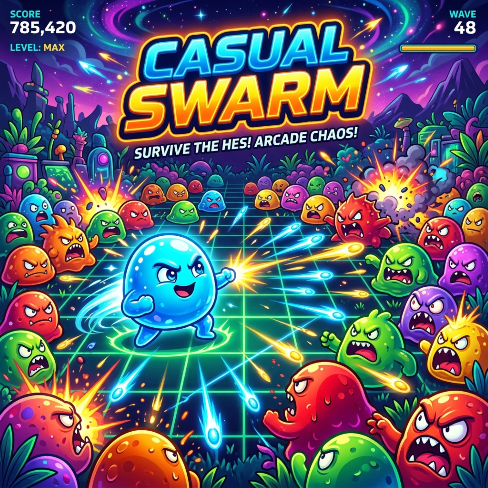

# 🎮 Jeux Web

Collection de mini-jeux développés en **HTML5, CSS et JavaScript** (Canvas, sans framework ni moteur de jeu).

## ▶️ Jouer en ligne

| Jeu | Description | Lien |
|---|---|---|
| **Casual Swarm** | Survie face à des vagues d'ennemis, armes et bonus à ramasser | [Jouer](https://isaaksu66.github.io/jeux-web/CasualSwarm/) |
| **Neon Swarm** | Version néon du jeu de survie en arène | [Jouer](https://isaaksu66.github.io/jeux-web/NeonSwarm/) |
| **Chrono Stack** | Plateforme / puzzle à boucle temporelle : empile tes anciens « toi » pour atteindre la sortie | [Jouer](https://isaaksu66.github.io/jeux-web/ChronoStack/) |
| **Mirror Run** | Deux coureurs, un seul bouton, des obstacles en miroir : garde-les en vie tous les deux | [Jouer](https://isaaksu66.github.io/jeux-web/MirrorRun/) |
| **Ragdoll Launcher** | Lance, rebondis, vole : jusqu'où iras-tu ? | [Jouer](https://isaaksu66.github.io/jeux-web/RagdollLauncher/) |
| **Schrödinger's Echo** | Puzzle-plateforme avec des échos du joueur | [Jouer](https://isaaksu66.github.io/jeux-web/SchrodingersEcho/) |
| **Neon Track Builder** | Jeu de conduite sur circuit néon | [Jouer](https://isaaksu66.github.io/jeux-web/BlockAndDrive/) |
| **Crime Simulator – Shadow Heist 3D** | Jeu d'infiltration / braquage | [Jouer](https://isaaksu66.github.io/jeux-web/CrimeSimulator/) |

## 🛠️ Technologies

- HTML5 Canvas
- JavaScript (ES6, architecture modulaire : `Game`, `Player`, `Enemy`, `Weapons`, `Particles`, `Renderer`…)
- CSS3

## 🚀 Lancer en local

Aucune installation nécessaire : ouvre le fichier `index.html` d'un jeu dans ton navigateur.

## 👤 Auteur

**Isa Aksu** ([@isaaksu66](https://github.com/isaaksu66)), étudiant en BTS SIO

© 2026 Isa Aksu. Tous droits réservés, voir [LICENSE](LICENSE).
